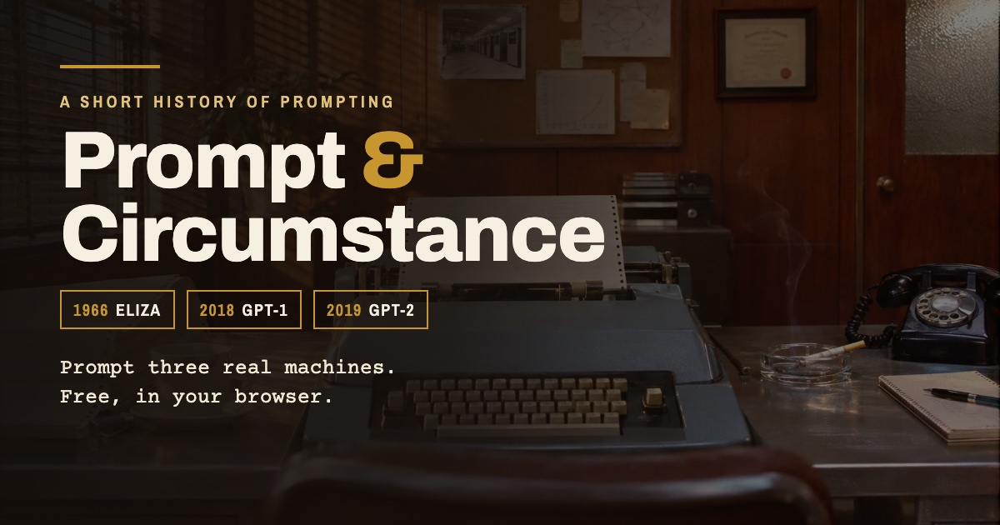

# Prompt & Circumstance

**A short history of prompting, in three machines.** A free browser game, about 20 minutes long. (Working title: Mad Models, which is why the repo and web address still use it.)

### ▶ [Play it](https://almostmike.github.io/mad-models/)

[](https://almostmike.github.io/mad-models/)

You sit down at three real machines from three eras of AI and learn to get something out of each one:

1. **1966, MIT Project MAC.** **ELIZA**, the first chatbot, on a clacking IBM 2741 printing terminal. Prompting means finding its trigger words.
2. **2018, a San Francisco startup.** **GPT-1**, in a research notebook. It doesn't answer; it finishes your text. Prompting means writing the first page, and turning the temperature dial.
3. **2019, Valentine's Day, after hours.** **GPT-2**, the model "too dangerous to release", as a boss fight. It's also suspiciously fond of vampire fanfiction (parody). Win with priming, formatting, examples and the magic words "TL;DR:".

The finale sends one prompt to all three machines side by side. Then a chat box dated November 30, 2022 appears, and you get a certificate.

## The machines are real

- **ELIZA** is a faithful TypeScript port of Joseph Weizenbaum's 1966 program and its DOCTOR script, by way of Anthony Hay's reconstruction. It reproduces the conversation in Weizenbaum's paper word for word, and the tests check that.
- **GPT-1 and GPT-2** are OpenAI's released weights (117M and 124M parameters), converted and quantized to 8-bit for the browser. They run on your own device with [Transformers.js](https://huggingface.co/docs/transformers.js), on WebGPU where available and WebAssembly otherwise. Each is about 120 MB, downloaded once from [Hugging Face](https://huggingface.co/almostmike/mad-models) and then cached.
- **Nothing you type leaves your browser.** There's no server, no account and no analytics.
- **Archive Mode** is for phones and older computers. It plays back real outputs recorded from the same models, and the game says so on screen.

## Playing

- **Best on:** a desktop or laptop with Chrome or Edge, with sound on. Other modern browsers fall back to a slower engine, and phones can play in Archive Mode.
- **Ages:** 13 and up. The models' output goes through a word filter, because 2018 and 2019 models had no safety training.
- **Help:** a hint strip at the bottom of each level offers a clear hint, "Show me" and "Try it". You can skip any goal after a few tries.
- **Accessibility:**
  - Fully keyboard-playable.
  - A Readable mode with crisp, high-contrast text.
  - Three text sizes.
  - Captions for sounds, plus screen-reader announcements.
  - Honors reduced-motion settings.
- **Saving:** progress, settings and your certificate name are kept in your browser only.

## Sources and credits

- **[docs/SOURCES.md](docs/SOURCES.md):** every fact on a placard or in a newsreel, with its source, and a list of what's made up. The in-game Museum lists the primary sources too.
- **[docs/CREDITS.md](docs/CREDITS.md):** the models, libraries, fonts, and the AI tools used for the art, music and voice.
- **[docs/PRD.md](docs/PRD.md)** and **[docs/VERIFICATION.md](docs/VERIFICATION.md):** the design, and how every objective was tuned against the real models.

Twilight belongs to Stephenie Meyer. Level 3 is parody, and a placard in the game says what was real.

## Develop

```bash
npm install
npm run dev
```

```bash
npm test
```

- **Deploy:** pushing to `main` runs the tests and deploys to GitHub Pages ([`.github/workflows/deploy.yml`](.github/workflows/deploy.yml)).
- **Model files:** the large files aren't in git. The game loads them from Hugging Face, pinned to a commit, and falls back to a GitHub Release copy. [`tools/models/README.md`](tools/models/README.md) explains how they were converted and checked.
- **Archive Mode recordings:** run `node tools/archive/record.ts`. Use `--only=<prefix>` to record new prompts without redoing the rest.
- **Link-preview image:** run `sh tools/og/render.sh`.
- **Model Lab:** an unlisted test page for the models, at `/lab.html`.

### Where things are

| Path | What |
|---|---|
| `src/engine/eliza/` | The ELIZA engine and the 1966 DOCTOR script |
| `src/engine/models/` | The model worker, Archive Mode, and the word filter |
| `src/levels/` | The three levels: content, objectives, and the screens you sit at |
| `src/finale/` | The three-machine finale, the 2022 coda, and the certificate |
| `src/museum/` | Placards and sources |
| `src/audio/` | Synthesized sound effects, music and voice playback |

## License

The code is MIT (see [LICENSE](LICENSE)). The scene images, music and voice clips are not covered by it. They were made with AI tools under those tools' terms; see [docs/CREDITS.md](docs/CREDITS.md). Prompt & Circumstance is non-commercial.
